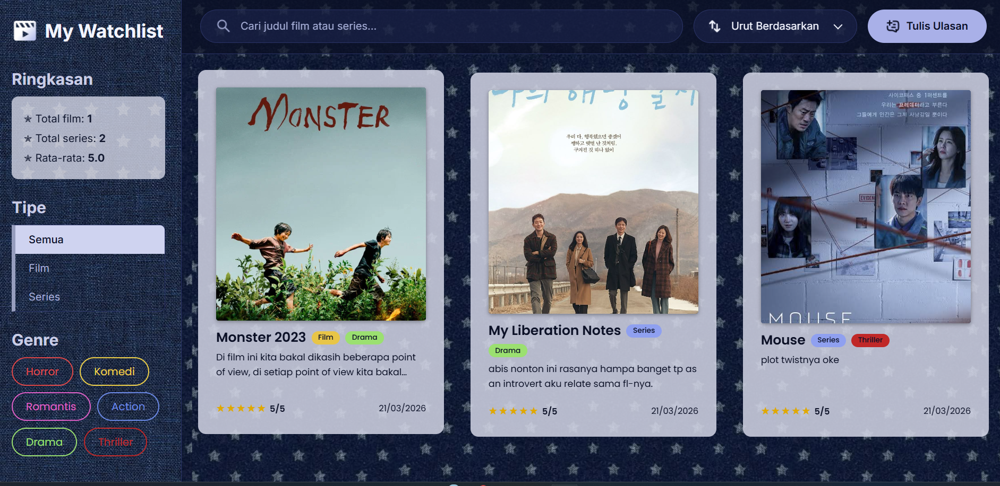
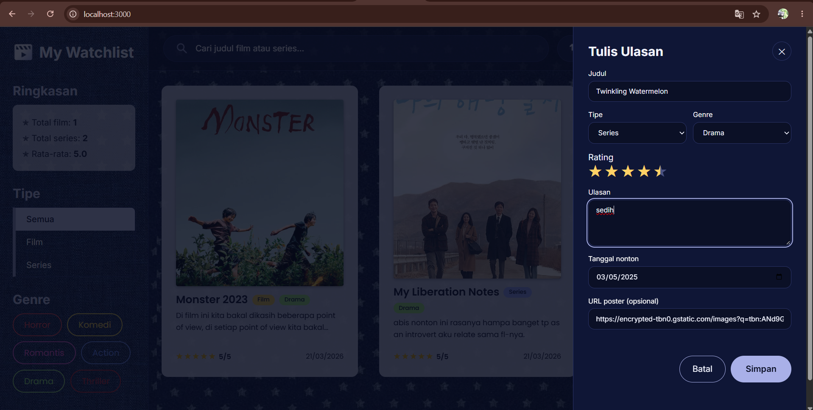
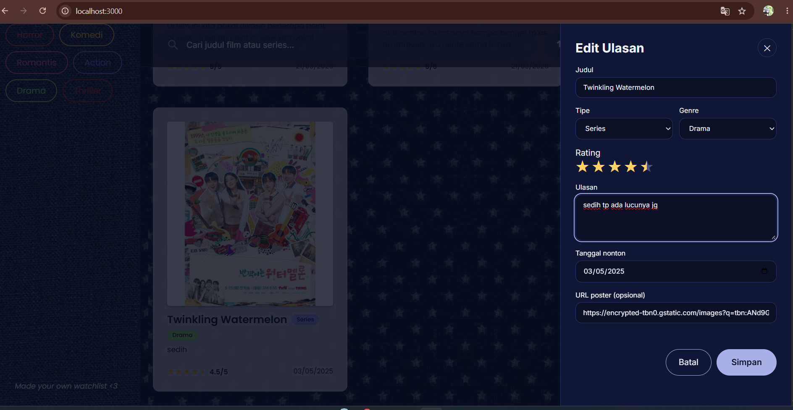
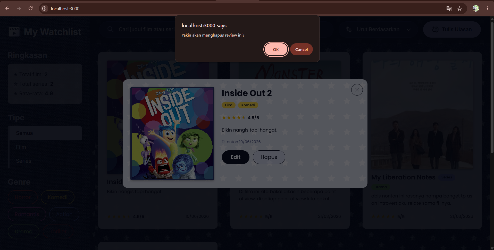
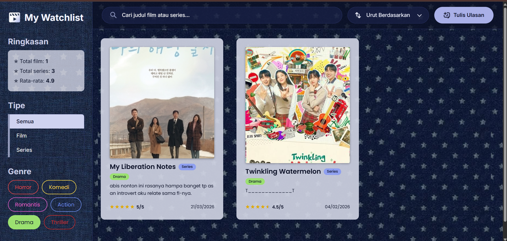
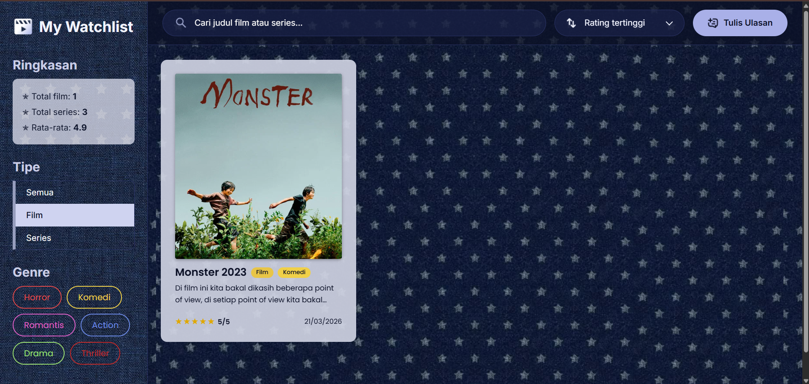

# Assignment Week 10 

| Nama | NRP | Kelas |
|---|---|---|
| Silfi Rochmatul A | 5027251008 | Pemweb B |

## Deskripsi Project

My Watchlist merupakan aplikasi web yang digunakan untuk mencatat, mengelola, dan memberi ulasan pada film maupun series yang telah ditonton oleh pengguna. Aplikasi ini menyediakan fitur untuk menambahkan, melihat, mengubah, dan menghapus data tontonan.

Pada Assignment Week 10, aplikasi dikembangkan pada bagian backend dengan mengintegrasikan database dan ORM untuk mengelola penyimpanan serta pengolahan data tontonan.

- Database: Neon (PostgreSQL)
- ORM: Prisma

## Fitur

- Menampilkan daftar film dan series.
- Menambahkan data tontonan.
- Mengedit informasi tontonan.
- Menghapus data tontonan.
- Memfilter tontonan berdasarkan tipe dan genre.
- Mengurutkan daftar tontonan.
- Menampilkan rating dan ulasan.
- Menampilkan ringkasan jumlah film, series, dan rata-rata rating.

## Struktur Project

```
008-pweb-week10-backend/
├── front-end/
│   ├── images/
│   ├── index.html
│   ├── script.js
│   └── style.css
│
├── prisma/
│   ├── migrations/
│   ├── schema.prisma
│   └── seed.ts
│
├── src/
│   ├── controllers/
│   │   └── reviews.controller.ts
│   ├── data/
│   │   └── reviews.ts
│   ├── generated/
│   │   └── prisma/
│   ├── lib/
│   │   └── prisma.ts
│   ├── middleware/
│   │   └── request-logger.ts
│   ├── routes/
│   │   └── reviews.routes.ts
│   ├── app.ts
│   └── index.ts
│
├── .env.example
├── .gitignore
├── package.json
├── package-lock.json
├── prisma7.config.ts
├── skills-lock.json
├── tsconfig.json
└── README.md
```

## Installation & Setup

1. Clone repository:

```bash
git clone `https://github.com/seelfie/008-pweb-week10-backend.git`
```

2. Masuk ke direktori project:

```bash
cd 008-pweb-week10-backend
```

3. Install dependencies:

```bash
npm install
```

4. Buat file `.env` berdasarkan `.env.example` dan sesuaikan konfigurasi database.

5. Jalankan migrasi database menggunakan ORM:

```bash
npx prisma migrate deploy
```

6. Generate prisma client 
```bash 
npx prisma generate
```

## Running the Application

Jalankan backend menggunakan:

```bash
npm run dev
```

Kemudian buka melalui browser atau extension.

## API 

| Method | Endpoint | Description |
|---|---|---|
| GET | /reviews | Mendapatkan seluruh data tontonan |
| GET | /reviews/:id | Mendapatkan detail tontonan berdasarkan ID |
| POST | /reviews | Menambahkan data tontonan |
| PUT | /reviews/:id | Mengubah data tontonan |
| DELETE | /reviews/:id | Menghapus data tontonan |

## Screenshots

- Homepage


- Tulis Ulasan


- Edit Ulasan


- Hapus Ulasan 


- Filter
  - Filter genre

    

  - Filter tipe
  
    